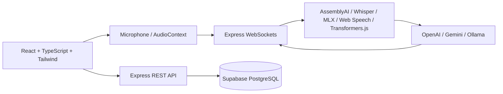

# Voxora — Real-Time AI Speech to Text & Translation

**Your Voice. Instantly Understood.**

Voxora is a voice-first full-stack application for live multilingual speech transcription, real-time translation, sermon and theological review, and searchable transcript history.

---

## 🛠️ Technology Stack

Voxora is built strictly on the following modern, production-grade stack:

- **Frontend**: **React 18** + **TypeScript** + **Tailwind CSS**
  - Bundler: **Vite**
  - UI Components: **Radix UI** primitives & **shadcn/ui** ("new-york" style)
  - Routing: **Wouter**
  - State & Server Cache: **TanStack React Query**
  - Animation & Icons: **Framer Motion**, **Lucide React**
- **Backend**: **Node.js** + **Express**
  - Language: **TypeScript** (executed via `tsx` in dev, bundled with `esbuild` for production)
  - Real-Time Streaming: **`ws` (WebSockets)**
  - File/Audio Processing: **Multer**, **fluent-ffmpeg**
  - Security & Tokens: **`jose`** (Supabase JWT verification)
- **Database**: **Supabase**
  - Persistence: **PostgreSQL** on Supabase
  - Client: **`@supabase/supabase-js`**
  - Security: **Row Level Security (RLS)** with `auth.uid()` policies
  - Authentication: **Supabase Auth** (email/password & Bearer JWT validation)

---

## 🏗️ Architecture



### Data Flow
1. **Audio Capture**: The browser records raw audio through `AudioContext` and streams chunks over Express WebSockets (`/ws/transcribe` or `/ws/chunk-transcribe`).
2. **ASR (Speech Recognition)**: The server routes audio to the configured engine (AssemblyAI Streaming, OpenAI Whisper, Apple Silicon MLX Whisper, or client-side Web Speech / Transformers.js).
3. **Translation & Correction**: Raw speech is processed through LLM providers (OpenAI GPT-4o-mini, Google Gemini, or local Ollama) with glossary reinforcement.
4. **Broadcast & UI**: Final and provisional text streams back to the UI in real time and broadcasts to mobile listeners (`/listen`).
5. **Persistence**: Finalized transcripts are stored in Supabase PostgreSQL via authenticated Express endpoints.

---

## ✨ Features & Application Routes

| Route | View | Description |
|---|---|---|
| `/` | **Sermon Workspace** | Dual-pane segment grid for live speech, source review, target translation, glossary lookup, and Bible quote detection. |
| `/live` | **Live Subtitle Mode** | Subtitle display with audio waveform visualization, input level meter, VAD indicator, and export dialog. |
| `/listen` | **Listener Mode** | Ultra-lightweight, mobile-optimized real-time stream viewer for congregation or audience members. |
| `/history` | **Transcript History** | Searchable dashboard for saved transcripts with language filtering, search, and pagination. |
| `/transcriptions/:id` | **Transcript Detail** | Full viewer and editor for saved transcript records (title, transcript, translation). |
| `/auth` | **Authentication** | Sign in and registration powered by Supabase Auth. |

---

## 🗄️ Supabase Database Setup

### Migration
Database schema and security policies are defined in [migrations/0001_voxora_transcriptions.sql](migrations/0001_voxora_transcriptions.sql).

Execute the migration SQL directly in your **Supabase Dashboard > SQL Editor**:

```sql
create extension if not exists pgcrypto;

create table if not exists public.transcriptions (
  id uuid primary key default gen_random_uuid(),
  user_id uuid references auth.users(id) on delete cascade,
  title text not null default 'Untitled transcription',
  original_text text not null,
  translated_text text,
  language text not null default 'en',
  provider text not null default 'unknown',
  duration_seconds integer check (duration_seconds is null or duration_seconds >= 0),
  target_language text not null default 'en',
  created_at timestamptz not null default now(),
  updated_at timestamptz not null default now()
);

create index if not exists transcriptions_user_created_idx on public.transcriptions (user_id, created_at desc);
create index if not exists transcriptions_user_language_idx on public.transcriptions (user_id, language);

alter table public.transcriptions enable row level security;

create policy "Users can read their own transcriptions" on public.transcriptions
  for select using (auth.uid() = user_id);

create policy "Users can create their own transcriptions" on public.transcriptions
  for insert with check (auth.uid() = user_id);

create policy "Users can update their own transcriptions" on public.transcriptions
  for update using (auth.uid() = user_id) with check (auth.uid() = user_id);

create policy "Users can delete their own transcriptions" on public.transcriptions
  for delete using (auth.uid() = user_id);
```

---

## ⚙️ Environment Variables

Create a `.env` file in the project root based on `.env.example`:

```bash
cp .env.example .env
```

| Variable | Required | Description |
|---|---|---|
| `PORT` | No | Server port (default: `5001`). |
| `FRONTEND_ORIGIN` | No | Allowed origin for CORS (e.g. `http://localhost:5001`). |
| `SUPABASE_URL` | Yes (Backend) | Server-side Supabase project URL (`https://your-id.supabase.co`). |
| `SUPABASE_SERVICE_ROLE_KEY` | Yes (Backend) | Server-only Supabase service-role secret key. |
| `ALLOW_ANONYMOUS_PERSISTENCE` | Dev Only | Set to `true` to allow anonymous testing in local development. |
| `OPENAI_API_KEY` | Optional | Required for OpenAI Whisper transcription & GPT-4o-mini translation. |
| `ASSEMBLYAI_API_KEY` | Optional | Required for real-time AssemblyAI streaming. |
| `GEMINI_API_KEY` | Optional | Required for Google Gemini (Flash Lite) translation & improvement. |

---

## 🚀 Getting Started

### Prerequisites
- **Node.js**: v20 or higher
- **npm**: v9 or higher
- **ffmpeg**: Installed on system PATH (required for audio chunk processing)

### Installation
```bash
npm install
```

### Running Locally
```bash
# Start development server with Vite HMR + Express backend
npm run dev
```

Open `http://localhost:5001` in your browser.

---

## 📡 API & WebSocket Reference

### REST Endpoints

| Method | Endpoint | Description | Auth |
|---|---|---|---|
| `GET` | `/health` | Health check & Supabase configuration status | Public |
| `GET` | `/api/transcriptions` | List user transcriptions (with search, pagination) | Bearer Token |
| `POST` | `/api/transcriptions` | Create a new saved transcription record | Bearer Token |
| `GET` | `/api/transcriptions/:id` | Retrieve single transcription by ID | Bearer Token |
| `PUT` | `/api/transcriptions/:id` | Update transcription title or text | Bearer Token |
| `DELETE` | `/api/transcriptions/:id` | Delete transcription by ID | Bearer Token |
| `POST` | `/api/transcribe` | Transcribe uploaded audio file | Rate-limited |
| `POST` | `/api/translate` | Translate text via configured LLM provider | Rate-limited |
| `POST` | `/api/sermon/translate` | Translate batch of sermon segments | Rate-limited |
| `GET` | `/api/sermon/glossary/status` | Read loaded glossary status | Rate-limited |
| `POST` | `/api/sermon/glossary/add` | Append term to glossary CSV | Operator-only |
| `GET` | `/api/lan-address` | Local IP address for listener broadcast | Public |

### WebSocket Endpoints

| Path | Protocol | Purpose |
|---|---|---|
| `/ws/transcribe` | WebSocket | AssemblyAI real-time streaming audio pipeline |
| `/ws/chunk-transcribe` | WebSocket | Chunk-based transcription (OpenAI / MLX Whisper) |
| `/ws/sermon-broadcast` | WebSocket | Broadcasts sermon segment updates to listeners |
| `/ws/sermon-listen` | WebSocket | Listener subscription channel for incoming translations |

---

## 🧪 Testing & Verification

Voxora includes unit, integration, and regression suites executed with **Vitest**:

```bash
# Type-check TypeScript files without emitting
npm run check

# Run unit and integration tests
npm test

# Run regression tests
npm run test:regression

# Build frontend and server for production
npm run build

# Start production server
npm start
```

---

## 🎨 UI & Design Principles

- **Framework**: Tailwind CSS paired with accessible **Radix UI** primitives and **shadcn/ui**.
- **Typography**: Avenir Next / system sans-serif hierarchy for optimal readability during live sessions.
- **Color & Theming**: Automatic dark/light theme switching using semantic HSL CSS custom variables (`bg-background`, `text-foreground`, etc.).
- **Mobile-First Ergonomics**: One-handed operation with bottom-anchored action bars within thumb reach for recording, export, and navigation.
- **Flat Elevation**: Deliberately flat aesthetic with borders and contrast surfaces rather than heavy drop shadows.

---

## 🔒 Security & Best Practices

- **Strict Server Secrets**: `SUPABASE_SERVICE_ROLE_KEY` is exclusively accessed server-side and never exposed to the client.
- **Row Level Security**: Supabase tables enforce RLS so users can only ever query or modify their own transcriptions.
- **Input Validation**: All payloads are rigorously validated using **Zod** schemas.
- **SSRF & Traversal Protection**: Loopback protection for local Ollama endpoints and strict path sanitization for glossary file operations.
- **Rate Limiting**: Built-in per-IP rate limiting on translation and speech processing endpoints.

---

## 📄 License

MIT
